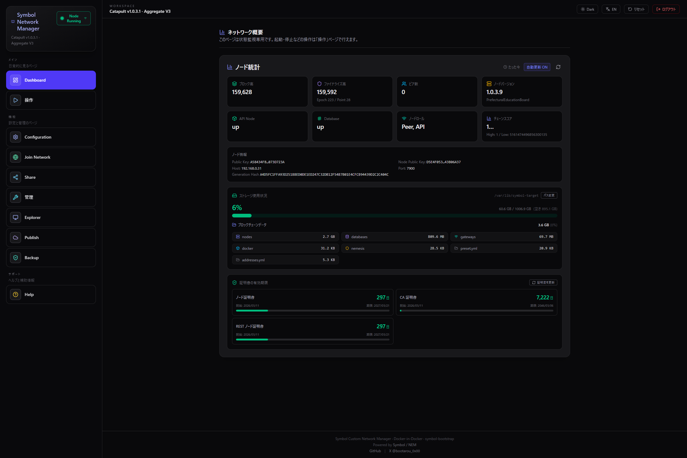

# Symbol Network Manager

Symbol ブロックチェーンのカスタムネットワーク（プライベートネットワーク）を Web UI で構築・管理するブロックチェーン-ネットワーク-ランチャー(BNL)です。


## 概要

Docker コンテナ 1 つを起動するだけで、Symbol ノードの設定・起動・停止・監視がすべてブラウザから操作できます。

- 🖥️ **Web UI** — React + Tailwind CSS によるモダンなダッシュボード
- 🔧 **ノード管理** — 起動 / 停止 / 再起動 / フルリセットをワンクリック
- 🌐 **ネットワーク参加** — Seed ファイルのインポートでカスタムネットワークへ、または公式ネットワーク（mainnet / testnet）へ参加
- 📊 **リアルタイム監視** — ブロック高・ファイナリティ高・ピア数・ハーベスト状態・ネットワーク通貨を表示
- 📜 **ターミナルログ** — Docker コンテナログを WebSocket でリアルタイム表示
- 🔑 **アドレス管理** — ノードのアドレス・公開鍵をワンクリックでコピー
- 💾 **バックアップ / リストア** — 設定のみ / フル（ブロックデータ含む）の 2 種類の zip バックアップに対応
- 🔍 **Explorer** — Symbol Explorer をビルド・起動して自ネットワークのブロックを閲覧
- ☁️ **ネットワーク公開** — Cloudflare 連携でノードをインターネットに公開
- 📡 **Beacon 書き出し** — ノードが観測したネットワーク状態を Transport 鍵で署名し、検証可能な Beacon File として書き出し
- 🔒 **ログイン認証** — `ADMIN_PASSWORD` を設定するとパスワード保護を有効化
- 🌍 **多言語対応** — 日本語 / English 切り替え
- 🌙 **ダーク / ライトテーマ** — 好みに応じて切り替え

## スクリーンショット

最新 UI のイメージです。



## アーキテクチャ

```
┌─────────────────────────────────────────────────────┐
│  symbol-manager コンテナ                            │
│                                                     │
│  ┌─────────────┐      ┌──────────────────┐         │
│  │  Frontend    │      │  Backend         │         │
│  │  React       │◄────►│  Express + WS    │         │
│  │  Vite :5173  │      │  :4000           │         │
│  └─────────────┘      └──────┬───────────┘         │
│                              │ docker.sock          │
└──────────────────────────────┼──────────────────────┘
                               ▼
                  ┌────────────────────────┐
                  │  symbol-bootstrap      │
                  │  (sibling containers)  │
                  │                        │
                  │  api-node-0  :7900     │
                  │  rest-gateway :3000    │
                  │  broker               │
                  │  db (MongoDB)         │
                  └────────────────────────┘
```

## 必要環境

| 要件 | バージョン |
|------|-----------|
| **Docker** | 20.10 以上 |
| **Docker Compose** | v2 以上 |
| **OS** | Windows / macOS / Linux |
| **メモリ** | 8 GB 以上推奨 |
| **ディスク** | 20 GB 以上の空き容量 |

> 💡 **推奨**: ネイティブ Linux + Docker Engine（Docker Desktop 不要）

## Windows へのインストール（WSL2）

Windows 10（ビルド 19041 以降）/ Windows 11 では、`BNL-Setup.bat` を実行するだけで、WSL2 の Ubuntu に BNL を導入できます。Docker Desktop は使いません（Ubuntu 内に Docker Engine を導入します）。

1. **`BNL-Setup.bat` を実行**します。タスクトレイアプリ BNL Tray の配布物に同梱しているほか、リポジトリのルートにもあります。実行するたびに `main` ブランチの最新の `install.ps1` を取得して実行します。
2. WSL2 が未導入の場合は、管理者権限（UAC）を求められます。WSL と仮想マシン プラットフォームを有効にしたあと Windows が再起動し、サインイン後にセットアップが自動で再開します。自動で再開しない場合は、もう一度 `BNL-Setup.bat` を実行してください。
3. 途中で次の 3 点を入力します。
   - **BNL の種類** — 1) BNL client（既定）/ 2) Symbol official client / 3) BNL Custom。違いは「[ブランチ構成](#ブランチ構成)」を参照
   - **`BIND_ADDRESS`** — 通常は `127.0.0.1`（この PC からのみアクセス可）
   - **管理者パスワード** — Web UI のログイン用（8〜64 文字）
4. 完了すると、ブラウザで BNL の Web UI（`http://127.0.0.1:5173`）が開きます。

補足:

- WSL の機能を有効にする前に **Windows Update の状態を確認**します。更新のインストール中や再起動待ちの場合は、先に Windows Update を完了するよう案内します（「無視して続行」も選べます）。
- BNL は `Ubuntu` という名前の WSL ディストリビューションの `/opt/bnl` に導入されます。既に `Ubuntu` を使っている PC では、その環境に Docker Engine と BNL が追加されます。
- インストールのログは `%LOCALAPPDATA%\BNL\install.log` に保存されます。
- **再実行すると更新**になります。既存の `.env` は維持され、管理者パスワードは「そのまま / 変更」を選べます。種類の既定値は、現在インストールされているブランチです。
- 起動 / 停止はタスクトレイアプリ **BNL Tray** から行えます（[tray/build/dist-README.ja.md](tray/build/dist-README.ja.md)）。

詳細は [install-windows.md](install-windows.md) を参照してください。macOS / Linux、または手動で Docker を操作する場合は、次の「クイックスタート」の手順を使います。

## クイックスタート（Docker）

### 1. リポジトリをクローン

```bash
git clone https://github.com/bootarou/blockchain-network-launcher.git
cd blockchain-network-launcher
```

### 2. 環境設定ファイルを作成（任意）

```bash
cp .env.example .env
```

デフォルト設定のままでも起動できます。以下を変更したい場合のみ `.env` を編集してください。

- `SYMBOL_TARGET_DIR` — ブロックチェーンデータの保存先（大容量ディスクに変更する場合）
- `ADMIN_PASSWORD` — 設定すると Web UI にログイン認証がかかります
- `BIND_ADDRESS` — デフォルトは `127.0.0.1`（ローカルのみ）。LAN や他 PC からアクセスする場合は `0.0.0.0` に変更（`ADMIN_PASSWORD` との併用推奨）

### 3. Docker イメージをビルド

```bash
docker compose build
```

> ⚠️ **Docker Compose v2.34+** (Docker Desktop 4.45+) では Bake がデフォルト有効になり、ビルドが失敗する場合があります。その場合：
>
> **PowerShell:**
> ```powershell
> $env:COMPOSE_BAKE="false"; docker compose build
> ```
> **Linux / macOS:**
> ```bash
> COMPOSE_BAKE=false docker compose build
> ```

### 4. コンテナを起動

```bash
docker compose up -d
```

### 5. ブラウザでアクセス

```
http://localhost:5173
```

> 💡 デフォルトでは `127.0.0.1` にのみバインドされるため、同じマシンからしかアクセスできません。他の PC からアクセスする場合は `.env` で `BIND_ADDRESS=0.0.0.0` を設定してください。
> `ADMIN_PASSWORD` を設定している場合は、初回アクセス時にログイン画面が表示されます。

## 使い方

### 新規ネットワーク構築（Nemesis ノード）

1. **Configuration** タブで Assembly = `dual`、Preset = `bootstrap` を選択
2. ホスト IP、フレンドリーネーム等を設定
3. **Start** で起動（設定は自動保存されます）— ネメシスブロックが生成されノードが起動

### 既存ネットワークに参加

1. **Join Network** タブでソースノードの REST API URL を入力
2. **Import Seed File** でネットワーク管理者から受け取った Seed ファイルをインポート
3. **Configuration** タブで設定を確認 → 操作ページで **Start**（設定は自動保存されます）

### 公式ネットワーク（mainnet / testnet）に参加

1. **Join Network** タブで既知ノード（mainnet / testnet）を選択、または REST API URL を入力して設定を取り込み
2. **Configuration** タブで設定を確認 → 操作ページで **Start**（設定は自動保存されます）

公式ネットワークでは Seed ファイルは不要です。ネットワーク設定は自動で取得されます。

### ネットワーク共有（他ノードの招待）

1. **Share Network** タブで Seed ファイルをダウンロード
2. 参加者に Seed ファイルと REST API URL を配布

### バックアップ / リストア

1. **Backup** タブで「設定のみ」または「フル（ブロックデータ含む）」を選んで zip をダウンロード
2. リストアは zip をアップロードするだけ。復元後は画面が自動で再読み込みされます

詳細な手順・注意事項は [docs/backup-restore.md](docs/backup-restore.md) を参照してください。

### Explorer / ネットワーク公開

- **Explorer** タブで Symbol Explorer をビルド・起動し、自ネットワークのブロックやトランザクションをブラウザで閲覧できます（デフォルトポート: `8090`）
- **Publish** タブで Cloudflare（API トークン・Zone ID・Account ID）を設定すると、ノードをインターネットに公開できます

詳しい操作手順は [MANUAL.md](MANUAL.md) を参照してください。

### Beacon の書き出し

**Beacon** タブで、稼働中のノードが観測したネットワーク状態を、そのノードの
**Transport 秘密鍵で署名した Beacon File**（`*.beacon.json`）として書き出せます。

Beacon は「この Transport Identity を持つノードが、この接続先で、このネットワーク
状態を観測した」という署名済みの宣言です。ネットワーク単位ではなく **ノード単位**
で生成します。

含まれる情報は次のとおりです。

| 項目 | 内容 |
|---|---|
| ネットワーク | `generationHash` |
| ノード識別 | `transportPublicKey`（署名者）／ `mainPublicKey`（関連付け情報） |
| P2P 接続先 | `p2pHost` / `p2pPort` |
| REST 接続先 | `apiHost` / `apiPort` / `apiScheme` |
| 観測ブロック | `height` / `blockHash` / `blockTimestamp` |

書き出しの流れです。

1. **Beacon** タブを開くと、設定と稼働ノードから値が自動収集されます
2. 収集時に `generationHash`・`mainPublicKey`・`transportPublicKey` が**実ノードの値と一致するか照合**されます。1 つでも食い違えば生成しません
3. 接続先（host / port / scheme）を確認し、必要なら編集します。**編集した値がそのまま署名対象**になります
4. ネットワークパスワードを入力して **「Beacon を書き出す」** をクリック
5. 署名後、SDK 自身でオフライン検証し、`format` / `hash` / `signature` / `metadata` がすべて有効な場合のみファイルがダウンロードされます

いくつか設計上の要点があります。

- **`p2pPort` / `apiPort` は「外部から実際に接続するポート」を優先**します。`docker port` で公開ポートを取得するため、`17900:7900` のような構成では 17900 が入ります
- **`apiScheme` はポート番号から推測しません。** 判定材料が無い場合は警告を出し、ユーザーが確認・変更します
- **P2P と REST は別ホストにできます。** Cloudflare トンネルやリバースプロキシで REST だけ別 FQDN になる構成に対応しています
- **プライベート IP でも生成は可能**です。外部検証ができない旨の警告を出すだけで、エラーにはしません（Gateway や VPN 経由の運用があるため）
- **Transport 秘密鍵はバックエンド内でのみ扱います。** 復号は署名の直前に行い、使用後は必ずゼロ化します。画面・ログ・API レスポンス・Beacon File のいずれにも出しません

Beacon Protocol の実装（正規化・ハッシュ・署名・ファイル形式・検証）は BNL 内には持たず、
独立した [Beacon SDK](https://github.com/bootarou/beacon) をバージョン固定
（`github:bootarou/beacon#v1.0.0`）で利用しています。Protocol の正本は SDK 側です。

> ℹ️ 現時点の BNL の役割は **Beacon File の生成まで**です。外部への送信、ブロック
> チェーンへの記録、第三者によるオンライン検証は後続フェーズ（BEYOND）が担当します。

## プロジェクト構成

```
├── backend/
│   ├── server.ts          # Express API + WebSocket サーバー
│   ├── beacon.ts          # Beacon 生成（収集・鍵照合・署名・自己検証）
│   ├── addresses-crypto.ts # addresses.yml の復号（server/beacon で共有）
│   ├── beacon.test.ts     # Beacon のテスト
│   └── package.json
├── frontend/
│   ├── src/
│   │   ├── App.tsx         # メインアプリケーション
│   │   ├── components/     # React コンポーネント
│   │   ├── i18n/           # 多言語リソース (ja/en)
│   │   ├── lib/            # API クライアント・ユーティリティ
│   │   └── theme/          # テーマ管理
│   ├── index.html
│   └── vite.config.ts
├── shared/                 # 実行時データ（custom-preset.yml などを生成。Git 管理外）
├── docs/                   # 手順書・障害レポート（「ドキュメント」参照）
│   └── screenshots/        # スクリーンショット
├── tray/                   # Windows タスクトレイアプリ BNL Tray（Go）と配布物
├── build/windows/          # 旧方式（Docker Desktop 前提）の Inno Setup インストーラー定義
├── draft/                  # 設計メモ・試作中の配布物
├── BNL-Setup.bat           # Windows 用インストール / 更新ランチャー（install.ps1 を取得して実行）
├── install.ps1             # Windows インストーラー本体（WSL2 の準備、BNL の種類の選択）
├── install-wsl.sh          # WSL2 Ubuntu 内のセットアップ（Docker Engine 導入・clone・起動）
├── install-windows.md      # Windows インストールの説明
├── install-dependencies.sh # backend / frontend の npm 依存を必要なときだけ再インストール
├── .env.example            # 環境設定のテンプレート
├── docker-compose.yml
├── Dockerfile
├── start.sh                # コンテナ起動スクリプト
└── MANUAL.md               # ユーザーマニュアル
```

## 技術スタック

### Frontend

- **React 19** + **TypeScript**
- **Vite** — 高速ビルド & HMR
- **Tailwind CSS 4** — ユーティリティファーストCSS
- **Lucide React** — アイコン
- **WebSocket** — リアルタイムログ・ステータス更新

### Backend

- **Node.js 20** + **TypeScript** (tsx)
- **Express 5** — REST API
- **WebSocket (ws)** — ターミナルログ配信
- **symbol-bootstrap** — ノード構成・起動管理
- **Docker CLI** — サイドカーコンテナ操作 (DinD パターン)
- **@nftdrive/beacon-sdk** — Beacon Protocol v1（正規化・署名・検証）。`v1.0.0` 固定

## 環境変数

`.env` ファイル（`.env.example` をコピーして作成）で設定します。

| 変数 | デフォルト | 説明 |
|------|-----------|------|
| `SYMBOL_TARGET_DIR` | `/var/lib/symbol-target` | symbol-bootstrap のターゲットディレクトリ（ブロックデータ保存先） |
| `ADMIN_PASSWORD` | （空 = 認証なし） | Web UI の管理パスワード。設定するとログイン認証が有効化 |
| `BIND_ADDRESS` | `127.0.0.1` | Web UI ポート (4000, 5173) のバインドアドレス。`0.0.0.0` で LAN / リモートからアクセス可 |
| `SYMBOL_BOOTSTRAP_REPO` | `https://github.com/bootarou/symbol-bootstrap.git` | symbol-bootstrap の Git リポジトリ URL（ビルド時） |
| `NODE_ENV` | `development` | 実行環境 |
| `PORT` | `4000` | バックエンド API ポート |

## ポート一覧

| ポート | 用途 |
|--------|------|
| `5173` | Frontend (Vite dev server) — `BIND_ADDRESS` にバインド（デフォルト: ローカルのみ） |
| `4000` | Backend API & WebSocket — `BIND_ADDRESS` にバインド（デフォルト: ローカルのみ） |
| `3000` | Symbol REST Gateway (symbol-bootstrap が管理) |
| `7900` | Symbol P2P ノード (symbol-bootstrap が管理) |
| `8090` | Symbol Explorer（Explorer 起動時のデフォルト、変更可） |

## ドキュメント

利用・運用:

- [MANUAL.md](MANUAL.md) — 詳細なユーザーマニュアル（Docker Host Mode、nodeEqualityStrategy、トラブルシューティング等）
- [install-windows.md](install-windows.md) — Windows（WSL2）へのインストールと更新
- [tray/build/dist-README.ja.md](tray/build/dist-README.ja.md) — タスクトレイアプリ BNL Tray の取扱説明書
- [docs/setup-update.ja.md](docs/setup-update.ja.md) — 再セットアップ時の依存更新とディスク容量
- [docs/backup-restore.md](docs/backup-restore.md) — バックアップ / リストア手順書（バックアップの種類、ケース別の復元動作、注意事項）
- [docs/fast-sync.ja.md](docs/fast-sync.ja.md) — 高速同期（新規ノードの初回起動前に、パッケージやフルバックアップのチェーンデータを取り込む）
- [docs/local-recovery.md](docs/local-recovery.md) — ローカルのチェーンデータ復旧（英語）
- [docs/certificate-renewal.ja.md](docs/certificate-renewal.ja.md) — CA 鍵を維持した証明書の更新
- [docs/node-runtime-settings.ja.md](docs/node-runtime-settings.ja.md) — Debug ログとファイルディスクリプター上限の設定
- [docs/wsl-lan-setup.md](docs/wsl-lan-setup.md) — WSL2 ホストの LAN 公開手順書（mirrored モード / portproxy、ファイアウォール設定）

調査・障害レポート:

- [docs/join-config-sync-audit.md](docs/join-config-sync-audit.md) — 参加ノードに同期されない設定の棚卸し（REST から取得できない設定と、同期が途中で止まる原因）
- [docs/incident-2026-07-04-join-node-crash.md](docs/incident-2026-07-04-join-node-crash.md) — 障害レポート：JOIN ノードがエポック2到達後にクラッシュループする問題
- [docs/incident-2026-09-23-broker-recovery.ja.md](docs/incident-2026-09-23-broker-recovery.ja.md) — 障害レポート：Windows 再起動後に broker が起動しなくなった問題の調査と復旧

## ブランチ構成

BNL は用途別のブランチで提供しています。`main` は公式 catapult イメージ（`symbolplatform/symbol-server`）だけを使う標準版です。Windows インストーラー（`BNL-Setup.bat`）では、上の 3 つを「種類（edition）」として選びます。

| インストーラーでの名前 | ブランチ | 既定の catapult イメージ | 内容 |
|---|---|---|---|
| 1) BNL client（既定） | `feat-empty-block-policy-cf` | `nftdrive/bnl-catapult-server:1.0.3.9-cf1-ebp-fpg` | BNL 版 catapult（chainFinalizationHeight / emptyBlockPolicy / FPG）。公式 1.0.3.9 / 1.0.3.7 / 1.0.3.6 も選択可 |
| 2) Symbol official client | `main` | `symbolplatform/symbol-server:gcc-1.0.3.9` | 公式 catapult のみ。1.0.3.6 / 1.0.3.7 / 1.0.3.9 から選択 |
| 3) BNL Custom（開発者向け） | `feat-custom-catapult` | 同上（公式のまま） | 自前ビルドの catapult イメージを検証する土台 |
| （一覧には表示しない） | `feat-PQC-custom-catapult` | `nftdrive/bnl-catapult-server-pqc:1.0.3.9-bnl` | 耐量子計算機暗号（PQC）専用版 |
| （一覧には表示しない） | `feat-empty-block-policy` | `nftdrive/bnl-catapult-server-pqc:1.0.3.9-bnl-ebp` | PQC 版 + 空ブロック抑制 |

PQC の 2 ブランチはインストーラーの選択肢に表示しませんが、ブランチ名を入力すればインストールできます。

派生の系統は 2 本に分かれます。ブランチ名からは読み取れませんが、**`-cf` が付く方が非 PQC** です。

```
main
 ├─ feat-custom-catapult            … カスタムイメージ対応（非 PQC）
 │   └─ feat-empty-block-policy-cf  … BNL 統合イメージを既定に
 └─ feat-PQC-custom-catapult        … PQC 専用
     └─ feat-empty-block-policy     … PQC + 空ブロック抑制
```

### feat-custom-catapult

`.env` の `CUSTOM_SERVER_IMAGE` / `CUSTOM_CONFIG_PATCHES` で、ローカルビルドの catapult イメージと追加 config プロパティを Configuration の選択肢に加えられます。未設定なら main と同じ動作で、既定イメージは公式のままです。追加したキーは Configuration UI で編集でき、REST の `/network/properties` にも公開されます。設定例は [.env.example](.env.example) に記載しています。

### feat-empty-block-policy-cf

`feat-custom-catapult` の子孫です。非 PQC の統合 BNL イメージ `nftdrive/bnl-catapult-server:1.0.3.9-cf1-ebp-fpg` を既定で提供します。公式 catapult 1.0.3.9 / 1.0.3.7 / 1.0.3.6 も引き続き選べます。

| 機能 | 内容 |
|---|---|
| `chainFinalizationHeight` | ブロック生成を停止するチェーンの高さ |
| `emptyBlockPolicy` | 空ブロック抑制（トランザクションが無い間のブロック生成を抑える） |
| FPG | ファイナライズ停止の修正機能 |

BNL イメージを選ぶと、必要な config プロパティ（`config-network.properties` の `[chain]`）が自動で注入されます。既定値は `chainFinalizationHeight = 0`、`emptyBlockPolicy = normal`、`emptyBlockHeartbeatInterval = 86400s` です。プライベートネットワークでは Configuration 画面で変更できます。

mainnet / testnet でも、Configuration の Server Image で「BNL Catapult 1.0.3.9 FPG」を選べます。この場合、BNL 独自の設定は公式ネットワークと同じ動作になる上記の既定値に固定されます。

旧イメージ `1.0.3.9-cf1-ebp`（FPG なし）で作成したノードは引き続き読み込めますが、新規ノードの選択肢には表示されません。

### feat-PQC-custom-catapult

耐量子計算機暗号版です。symbol-bootstrap も `pqc-bootstrap` ブランチ（ML-DSA-44 の鍵・証明書、iVRF による VrfKeyLink）を使い、UI も PQC 専用に絞られています。

> ⚠️ **公式ネットワーク（mainnet / testnet）には参加できません。** 公式ノードの URL を指定すると、取り込み時に `official Symbol network (ed25519)` エラーで明示的に拒否されます。

### feat-empty-block-policy

`feat-PQC-custom-catapult` の子孫です。空ブロック抑制ポリシー（`emptyBlockPolicy`）を追加し、private / data chain では `heartbeat`（既定 86400 秒間隔）を既定値にします。トランザクションが無い間もブロックを生成し続ける従来動作（`normal`）に対して、ディスク消費を抑えられます。

### 派生ブランチを運用する場合

`main` の取り込み状況は次のとおりです（2026-10-18 時点）。

- `feat-custom-catapult` / `feat-empty-block-policy-cf` — 取り込み済み。ただし Windows インストーラー（`install.ps1`）関連の変更は含みません。インストーラーは常に `main` の `install.ps1` が使われるため、動作への影響はありません。
- `feat-PQC-custom-catapult` / `feat-empty-block-policy` — 2026-08-18 以降の `main` の変更は、個別に適用した一部の修正を除いて取り込んでいません。

**main の修正は定期的に取り込んでください。** 取り込みが遅れると、JOIN ノードの `proof.index.dat` 問題やクラッシュ自動復旧、インフレーション設定の不一致対策といった既知の障害対策が入らないまま運用することになります。これらは catapult のバージョンや PQC の有無に依存しないため、どの派生ブランチでも同じ問題が発生します。

## ライセンス

ISC
